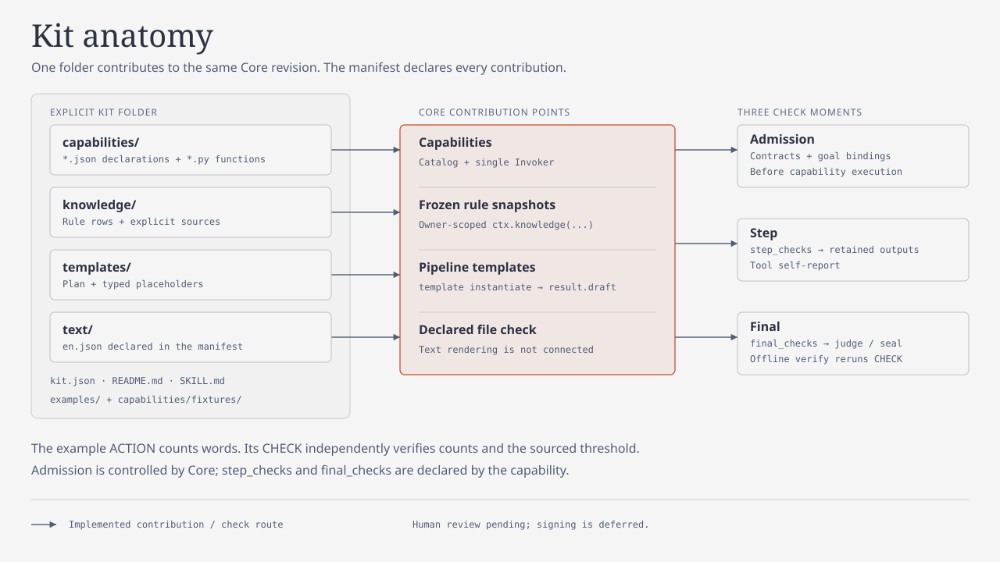

# Add a Kit in about 30 minutes

A Kit is a folder of contributions to DNA Design Core. **Capabilities** do work
and check it; **rules** hold sourced decisions; **templates** describe steps;
**text** declares Kit wording. This walkthrough copies a small word counter,
renames it, runs a goal and plan, seals a checked report, then verifies a copy.
No DNA knowledge or existing Kit source is needed.



Budget: 0.5 hour for a developer familiar with Python and PowerShell, estimated,
not measured with a new developer. Use **PowerShell 7**, Python 3.11 or newer,
and the already provisioned `.venv`. Start in `code/genome-revival-toolkit/`
inside the complete checkout. Commands use local dependencies only. This example
depends on this checkout's Core development version and contracts; the manifest
pins the current development patch interval. It does not promise compatibility
with another Core revision. Review the interval when publishing a real Kit.

Every block marked **Copyable** is executed verbatim, in order, by
`tests/e2e/run_add_a_kit.py`. Keep the same PowerShell session for all ten blocks.
The helper checks native exit codes, retains JSON receipts and stops on an
unexpected result. `describe` wraps metadata in `result.description`.

## 1. Copy the template into a new folder

Copyable. Creates a fresh temporary workspace and a folder named `phrase-counter`.
The wrapper still invokes the single public CLI; it is a shell convenience,
not a Kit entry point. Keep the printed workspace path to inspect the results.

<!-- copyable: 01-copy -->
```powershell
Set-StrictMode -Version Latest
$ErrorActionPreference = 'Stop'
$PSNativeCommandUseErrorActionPreference = $false
if ($PSVersionTable.PSVersion.Major -lt 7) { throw 'Use PowerShell 7.' }
$Project = (Get-Location).Path
$Python = (Resolve-Path '.venv/Scripts/python.exe').Path
$Cli = Join-Path $Project 'src/dna_design_core/application/cli.py'
$env:PYTHONPATH = Join-Path $Project 'src'
$Work = Join-Path ([IO.Path]::GetTempPath()) ('grt-add-a-kit-' + [guid]::NewGuid().ToString('N'))
$null = New-Item -ItemType Directory -Path $Work
Write-Output "WORK_DIRECTORY=$Work"
$Kit = Join-Path $Work 'phrase-counter'
Copy-Item -LiteralPath (Join-Path $Project 'examples/kit-template') -Destination $Kit -Recurse
$Receipts = [Collections.Generic.List[object]]::new()
function Save-Json([string]$Path, $Value) {
    ConvertTo-Json -InputObject $Value -Depth 100 | Set-Content -LiteralPath $Path -Encoding utf8
}
function Invoke-Grt([string[]]$Arguments, [int]$ExpectedExit = 0) {
    $Index = $Receipts.Count
    $Raw = & $Python -X utf8 -B $Cli @Arguments --kit-dir $Kit 2> (Join-Path $Work "cli-$Index.stderr.txt")
    $Code = $LASTEXITCODE
    $Receipt = ($Raw -join "`n") | ConvertFrom-Json -AsHashtable
    $Receipts.Add(@{arguments=$Arguments; exit_code=$Code; receipt=$Receipt})
    Save-Json (Join-Path $Work 'receipts.json') $Receipts.ToArray()
    if ($Code -ne $ExpectedExit) { throw "Unexpected CLI exit $Code; see receipt $Index in $Work" }
    if ($ExpectedExit -eq 0 -and $Receipt.problems.Count) { throw "CLI problems in receipt $Index" }
    return $Receipt
}
Write-Output 'Copied phrase-counter; shell helpers ready.'
```

Expected: `WORK_DIRECTORY=...` and `Copied phrase-counter; shell helpers ready.`
The original template stays outside `kits/` and default discovery.

## 2. Rename the manifest and namespace

`kit.json` names the Kit and lists its four contributions. Capability `owner`
must be `kit:<manifest name>`. The Python package prefix is a loader mapping,
not an installed package. Update it with the capability namespace and rule IDs.
Keep the report field `word_count`: a data field is not a namespace.

Copyable. Renames identifiers throughout the copy, including its declarations,
fixtures, template and host skill. `requires_core` remains pinned to this example.

<!-- copyable: 02-manifest -->
```powershell
Get-ChildItem -LiteralPath $Kit -Recurse -File | Where-Object Extension -In '.json','.py','.md' | ForEach-Object {
    $Body = Get-Content -LiteralPath $_.FullName -Raw
    $Body = $Body.Replace('word-count','phrase-counter').Replace('word_count.','phrase_counter.')
    $Body = $Body.Replace('grt_kit_word_count','grt_kit_phrase_counter').Replace('PREFIX = "word_count"','PREFIX = "phrase_counter"')
    Set-Content -LiteralPath $_.FullName -Value $Body -Encoding utf8 -NoNewline
}
$Manifest = Get-Content -LiteralPath (Join-Path $Kit 'kit.json') -Raw | ConvertFrom-Json -AsHashtable
$KitName = $Manifest.name
$Namespace = $KitName.Replace('-','_')
$Version = $Manifest.version
if ($KitName -ne 'phrase-counter') { throw 'Manifest was not renamed.' }
Write-Output "name=$KitName owner=kit:$KitName namespace=$Namespace"
```

Expected: `name=phrase-counter owner=kit:phrase-counter namespace=phrase_counter`.

## 3. Write the first capability and export its declaration

`capabilities/contracts.py` contains the complete ACTION and CHECK declarations.
The ACTION accepts one string parameter, declares `reads_files` for frozen rule
access, and emits one document port named `report` with `output_role: analysis`. Its inline JSON
Schema specifies the five report fields, without changing a Core schema.
`@capability(ACTION)` attaches the same declaration to Python. Discovery reads
the exported JSON; editing Python alone does not update that JSON.

Copyable. Writes the entire ACTION using only `kernel.public` and its own
declarations, then exports both JSON declarations from that source of truth.
`ctx.knowledge` reads this run's frozen, owner-scoped rule, not a live rule file.

<!-- copyable: 03-action -->
```powershell
@'
"""One operation, one typed analysis document."""
from dna_design_core.kernel.public import Outcome, capability
from .contracts import ACTION, OWNER


@capability(ACTION)
def count_words(ctx: object, text: str) -> Outcome:
    rule = ctx.knowledge(OWNER + "/knowledge/minimum_words.json")
    minimum = rule["parameters"]["minimum_words"]
    count = len(text.split())
    return Outcome(documents={"report": {
        "text": text, "word_count": count, "minimum_words": minimum,
        "meets_minimum": count >= minimum, "rule_id": rule["id"],
    }})
'@ | Set-Content -LiteralPath (Join-Path $Kit 'capabilities/count.py') -Encoding utf8
& $Python -X utf8 -B -c 'import json,runpy,sys; from pathlib import Path; p=Path(sys.argv[1]); d=runpy.run_path(str(p/"capabilities/contracts.py")); [(p/("capabilities/"+name+".json")).write_text(json.dumps(d[key],indent=2)+"\n",encoding="utf-8") for key,name in [("ACTION","count_words"),("CHECK","check_count")]]' $Kit
if ($LASTEXITCODE -ne 0) { throw 'Declaration export failed.' }
Write-Output 'ACTION written; two declarations exported.'
```

Expected: `ACTION written; two declarations exported.` Change the declaration's
ports and schemas together with Python when adding another kind of result.
Return documents via `Outcome(documents=...)`; a CHECK returns verdicts only.

## 4. Write one sourced rule-table row

A `rule-v1` file is one row: identity, purpose, parameters, applicability,
evaluator, source, limits and review reference. Our sole threshold is three.
Its source is explicitly a tutorial contract, class `project_contract`, with
`verification_status: unverified`. It establishes no scientific rule.

Copyable. Edits the rule data, preserving its source and absent human review.
For another threshold, change both the stated contract and the constructed
control answers. A source-incomplete rule belongs in `knowledge/drafts/` and
must stay outside `contributes.knowledge`.

<!-- copyable: 04-rule -->
```powershell
$RulePath = Join-Path $Kit 'knowledge/minimum_words.json'
$Rule = Get-Content -LiteralPath $RulePath -Raw | ConvertFrom-Json -AsHashtable
$Rule.parameters.minimum_words = 3
$Rule.source.source_class = 'project_contract'
$Rule.source.citation = 'Tutorial example, not a scientific claim: at least three whitespace-separated words meet the example minimum.'
$Rule.source.verification_status = 'unverified'
Save-Json $RulePath $Rule
Write-Output "minimum=$($Rule.parameters.minimum_words) source=$($Rule.source.source_class) verification=$($Rule.source.verification_status)"
```

Expected: `minimum=3 source=project_contract verification=unverified`.
`does_not_establish` in the manifest and declarations explicitly says:
"This is a tutorial example, not any experimental or scientific claim."

## 5. Write a pipeline template

A template is a plan with typed whole-value placeholders. Here `text` becomes
a string, and `goal_digest` binds the declared goal. The output uses the
capability's `report` port and target `t1`, which our goal will require.
It keeps the ACTION's `analysis` role; the plan cannot select a lower role.

Copyable. Writes a complete one-step template, with exact capability version.

<!-- copyable: 05-template -->
```powershell
$Template = @{
    schema='pipeline-template-v1'; version=1; goal_digest='{{goal_digest}}'
    steps=@(@{step_id='count'; use="$Namespace.count_words@$Version"; inputs=@{}; params=@{text='{{text}}'}; why='Count a tutorial phrase and apply the frozen example rule.'})
    outputs=@(@{name=$KitName; from=@{step='count'; port='report'}; target='t1'})
    params_schema=@{
        type='object'; additionalProperties=$false; required=@('goal_digest','text')
        properties=@{
            goal_digest=@{type='string'; description='Digest returned by goal declare.'}
            text=@{type='string'; description='Phrase to count; whitespace separates words.'}
        }
    }
    authorship=@{kind='ai'; tool_or_model='Codex'; date='2026-10-17'}
}
Save-Json (Join-Path $Kit 'templates/count.json') $Template
Write-Output "template=$KitName.count output=$KitName target=t1"
```

Expected: `template=phrase-counter.count output=phrase-counter target=t1`.

## 6. Write the CHECK and run independent positive and negative controls

The CHECK scans transitions from whitespace to non-whitespace, independently
of the ACTION's `split()`. It compares the entire retained report with recorded
step parameters and the frozen rule. It does not trust the report's own input.
The positive fixture fixes four literal tokens. The negative fixture deliberately
reports five. Both are executed at step and final moments by the unit tests in
step 9; a fixture file by itself is not evidence of a successful test.

Copyable. Writes the complete CHECK. `document_id(rule)` is a public content
digest for `rule_refs`; a readable rule name does not fit that verdict field.

<!-- copyable: 06-check -->
```powershell
@'
"""Read-only check; counting algorithm is independent of the ACTION's split."""
from dna_design_core.kernel.public import Outcome, ToolkitError, capability, document_id, make
from .contracts import CHECK, LIMITS, OWNER, PREFIX, VERSION


@capability(CHECK)
def check_count(ctx: object) -> Outcome:
    candidate = ctx.view.candidate
    matches = []
    try:
        rule = ctx.knowledge(OWNER + "/knowledge/minimum_words.json")
        minimum = rule["parameters"]["minimum_words"]
        for step in ctx.view.steps():
            if step["definition"]["use"].split("@")[0] != PREFIX + ".count_words" or step["superseded"]:
                continue
            if candidate.get("moment") == "step":
                if step["definition"]["step_id"] != candidate["step_id"]:
                    continue
                retained = candidate["step_outputs"]
            elif step["completed"]:
                retained = step["completed"]["payload"]
            else:
                continue
            text = step["started"]["payload"]["params"]["text"]
            count, in_word = 0, False
            for character in text:
                if character.isspace():
                    in_word = False
                elif not in_word:
                    count += 1
                    in_word = True
            expected = {"text": text, "word_count": count, "minimum_words": minimum,
                        "meets_minimum": count >= minimum, "rule_id": rule["id"]}
            identity, = retained["outputs"]["documents"]["report"]
            report = ctx.view.document(identity)
            matches.append(report == expected)
        outcome = ("PASS" if all(matches) else "FAIL") if matches else "UNKNOWN"
    except (ToolkitError, KeyError, TypeError, ValueError):
        outcome = "UNKNOWN"
    return Outcome(verdicts=[make(
        check={"id": PREFIX + ".check_count", "version": VERSION}, scope="content_model",
        moment=candidate.get("moment", "final"), issuer=candidate.get("issuer", "check_capability"),
        subject={"kind": "run", "id": ctx.view.events()[0]["run_id"]}, outcome=outcome,
        summary="Retained word counts and threshold decisions checked against recorded text.",
        evidence={"matches": matches}, rule_refs=[document_id(rule)] if matches else [],
        does_not_establish=LIMITS,
    )])
'@ | Set-Content -LiteralPath (Join-Path $Kit 'capabilities/check.py') -Encoding utf8
Write-Output 'CHECK written; controls will run in step 9.'
```

Expected: `CHECK written; controls will run in step 9.` A correctly counted
two-word phrase has `meets_minimum: false` and still passes the accuracy CHECK.
If the goal must require a particular decision, add an explicit goal constraint
with a suitable CHECK. This tutorial's goal only requests an accurate report.

### The three check moments

| Moment | Who controls it | Template example |
| --- | --- | --- |
| Admission | Core validates the declared input, parameter and output contracts before execution. Kit supplies those contracts. | `text` must be a string; `report` has an inline document schema; submit creates no capability calls. |
| Step | ACTION's `step_checks` lists CHECK IDs, called with a read-only view of retained step outputs. | `["phrase_counter.check_count"]` produces a `tool_self_report` verdict. A failed self-report does not itself halt execution; inspect it. |
| Final | Core unions its baseline requirements, goal constraints and used ACTIONs' `final_checks`. | `[{"check":"phrase_counter.check_count"}]` requires a fresh passing CHECK for seal. `UNKNOWN` also blocks sealing. |

Sealing repeats required checks on the staged package. `verify` re-runs checks
marked `offline: true` when matching code is available. A step self-report is
not a substitute for a final verdict. No new check moment or profile is added.

## 7. Load explicitly and describe

Copyable. Shows that default discovery excludes the teaching Kit, then describes
the explicit copy. Pass `--kit-dir` on **every** CLI invocation, including
`run create`, `template instantiate` and portable `verify`. `describe` is metadata
inspection; execution first happens after a submitted plan.

<!-- copyable: 07-describe -->
```powershell
$Raw = & $Python -X utf8 -B $Cli describe kits
if ($LASTEXITCODE -ne 0) { throw 'Default discovery failed.' }
$Baseline = ($Raw -join "`n") | ConvertFrom-Json -AsHashtable
Save-Json (Join-Path $Work 'default-discovery.json') $Baseline
if (@($Baseline.result.description | Where-Object name -In 'word-count','phrase-counter').Count) { throw 'Teaching Kit was discovered by default.' }
$Listed = Invoke-Grt -Arguments @('describe','kits')
if ($Listed.result.kit_diagnostics.Count) { throw 'Kit metadata was rejected.' }
if (@($Listed.result.description | Where-Object name -EQ $KitName).Count -ne 1) { throw 'Explicit Kit missing.' }
$ActionInfo = Invoke-Grt -Arguments @('describe','capability',"$Namespace.count_words")
$CheckInfo = Invoke-Grt -Arguments @('describe','capability',"$Namespace.check_count")
$TemplateInfo = Invoke-Grt -Arguments @('describe','template',"$KitName.count")
Write-Output "explicit=$KitName action=$($ActionInfo.result.description.role) check=$($CheckInfo.result.description.role)"
```

Expected: `explicit=phrase-counter action=ACTION check=CHECK` and no Kit diagnostics.
Core also reports its existing notice that explicitly loaded Kit code runs with
the operator's permissions. Load code you intend to execute.

## 8. Declare a goal, submit the plan, execute, judge, seal and verify

Copyable. Takes `result.goal_digest`, then submits **`result.draft`** from the
template receipt. The request omits `origin`: Core derives constraint provenance
from the quote. The report target matches `t1` in the goal.

The second verification has only a copied sealed data directory at its location.
The original run is moved within this new workspace. Keep the seal directory's
basename. Python, matching Core and the unchanged explicit Kit code are still
needed to re-run checks; the seal does not bundle executable Kit source.

<!-- copyable: 08-lifecycle -->
```powershell
$Run = Join-Path $Work 'run'
$Created = Invoke-Grt -Arguments @('run','create',$Run)
$GoalPath = Join-Path $Kit 'examples/goal.json'
$Declared = Invoke-Grt -Arguments @('goal','declare','--run',$Run,'--request',$GoalPath)
$Request = @{goal_digest=$Declared.result.goal_digest; text='red green blue gold'}
$RequestPath = Join-Path $Work 'template-request.json'
Save-Json $RequestPath $Request
$Instantiated = Invoke-Grt -Arguments @('template','instantiate',"$KitName.count",'--request',$RequestPath)
$PlanPath = Join-Path $Work 'pipeline.json'
Save-Json $PlanPath $Instantiated.result.draft
$Submitted = Invoke-Grt -Arguments @('pipeline','submit','--run',$Run,'--request',$PlanPath)
$BeforeExecute = @(Get-Content -LiteralPath (Join-Path $Run 'journal.ndjson') | ForEach-Object { $_ | ConvertFrom-Json -AsHashtable })
if (@($BeforeExecute | Where-Object type -In 'step.started','call.recorded').Count) { throw 'Admission executed a capability.' }
$Executed = Invoke-Grt -Arguments @('run','execute','--run',$Run)
if ($Executed.state -ne 'COMPLETED') { throw 'Run did not complete.' }
$Judged = Invoke-Grt -Arguments @('judge','--run',$Run)
if ($Judged.result.unsatisfied.Count) { throw 'Required checks did not pass.' }
$Sealed = Invoke-Grt -Arguments @('seal','--run',$Run)
if (-not $Sealed.result.sealed) { throw 'No seal was created.' }
$OriginalVerification = Invoke-Grt -Arguments @('verify',$Run)
$Package = Split-Path $Sealed.result.manifest -Parent
$PortableParent = Join-Path $Work 'portable'
$null = New-Item -ItemType Directory -Path $PortableParent
$Portable = Join-Path $PortableParent (Split-Path $Package -Leaf)
Copy-Item -LiteralPath $Package -Destination $Portable -Recurse
$Retained = Join-Path $Work 'retained-run'
if ((Split-Path ([IO.Path]::GetFullPath($Run)) -Parent) -ne $Work -or (Split-Path ([IO.Path]::GetFullPath($Retained)) -Parent) -ne $Work) { throw 'Move must stay inside the tutorial workspace.' }
Move-Item -LiteralPath $Run -Destination $Retained
$PortableVerification = Invoke-Grt -Arguments @('verify',$Portable)
if (-not $PortableVerification.result.verified -or $PortableVerification.result.not_rerun.Count) { throw 'Portable checks were incomplete.' }
$Report = Get-Content -LiteralPath (Join-Path $Portable "$KitName.json") -Raw | ConvertFrom-Json -AsHashtable
if ($Report.word_count -ne 4 -or $Report.minimum_words -ne 3 -or -not $Report.meets_minimum) { throw 'Constructed answer differs.' }
$TamperParent = Join-Path $Work 'tampered'
$null = New-Item -ItemType Directory -Path $TamperParent
$Tampered = Join-Path $TamperParent (Split-Path $Portable -Leaf)
Copy-Item -LiteralPath $Portable -Destination $Tampered -Recurse
$ChangedFile = Join-Path $Tampered "$KitName.json"
$Bytes = [IO.File]::ReadAllBytes($ChangedFile)
$Bytes[0] = $Bytes[0] -bxor 1
[IO.File]::WriteAllBytes($ChangedFile, $Bytes)
$TamperVerification = Invoke-Grt -Arguments @('verify',$Tampered) -ExpectedExit 1
Save-Json (Join-Path $Work 'walkthrough-result.json') @{portable=$Portable; tampered=$Tampered; retained_run=$Retained; kit=$Kit; count=$Report.word_count; minimum=$Report.minimum_words; verified=$PortableVerification.result.verified; not_rerun=$PortableVerification.result.not_rerun}
Write-Output 'count=4 minimum=3 decision=True sealed=True portable=True tamper_exit=1'
```

Expected: `count=4 minimum=3 decision=True sealed=True portable=True tamper_exit=1`.
Four comes from the four written tokens, independently of either algorithm.
The tamper probe flips exactly one byte in a separate copy, retaining the valid
package. A zero exit from `judge` alone is insufficient: inspect `unsatisfied`.
`seal` returns exit 10 when qualification fails without a command error.

## 9. Check structure, schemas and the actual controls

Copyable. Checks Core structure, the registered schema fixtures and specification
consistency, then checks this external template's declarations, sources, public
imports, positive and negative controls, boundary counts and three source mutants.
The standard structural scanner covers `src/` and bundled `kits/`; the new unit
test explicitly covers the teaching template outside those directories.

<!-- copyable: 09-checks -->
```powershell
& $Python -X utf8 -B tools/check_structure.py
if ($LASTEXITCODE -ne 0) { throw 'Structure check failed.' }
& $Python -X utf8 -B tools/check_schemas.py
if ($LASTEXITCODE -ne 0) { throw 'Schema check failed.' }
Push-Location (Join-Path $Project '../..')
try {
    & $Python -X utf8 -B tools/spec_lint.py
    if ($LASTEXITCODE -ne 0) { throw 'Specification lint failed.' }
} finally { Pop-Location }
& $Python -X utf8 -B -m unittest tests.unit.test_kit_template -v
if ($LASTEXITCODE -ne 0) { throw 'Template controls failed.' }
Write-Output 'Structure, schemas, spec lint and template controls passed.'
```

Expected: zero structural findings, zero schema findings, zero hard specification
issues, `Ran 8 tests` followed by `OK`. These validate software contracts and
constructed examples. They do not measure a developer's completion time or
establish scientific acceptance. The end-to-end runner additionally checks the
copied Kit and portable package, not just this output text.

## 10. Leave human review to the responsible person

The responsible developer or scientific owner reviews meaning, sources and
limits. Reviewer names, dates and approvals belong to that person. This snapshot's
`review sign` command is deferred and returns `CHECK_UNAVAILABLE`; no interactive
signing is available. This is an implementation limit, not a completed review.
When its owner implements signing, the person must use that workflow. Until then,
report human review as pending and create no `review/` receipt.

Copyable. Probes that current public behavior without claiming any signature.

<!-- copyable: 10-review -->
```powershell
$ReviewPath = Join-Path $Work 'review-request.json'
Save-Json $ReviewPath @{}
$Review = Invoke-Grt -Arguments @('review','sign','--run',$Retained,'--request',$ReviewPath) -ExpectedExit 1
if ($Review.problems[0].code -ne 'CHECK_UNAVAILABLE') { throw 'Review behavior changed; update this tutorial.' }
if (@(Get-ChildItem -LiteralPath $Kit -Recurse -File | Where-Object { $_.FullName -match '[/\\]review[/\\]' }).Count) { throw 'A review receipt was created.' }
Write-Output 'Human review pending; no review receipt created.'
```

Expected: `Human review pending; no review receipt created.` Computational sealing
and portable verification are complete. Human review is not. Laboratory work:
`NOT_PERFORMED`. Official GitLab CI has not been executed; GitHub CI has not run.

## Common mistakes

| Symptom | Cause | Fix |
| --- | --- | --- |
| Kit absent from `describe` | Forgot `--kit-dir`, wrong folder, or metadata rejected. | Point to the folder containing `kit.json`; inspect `result.kit_diagnostics` on every describe receipt. |
| Cannot find implementation or wrong owner | Manifest, `owner`, namespace or `implemented_in` disagree. | Rename all together. `grt_kit_phrase_counter.capabilities.count:count_words` maps to `capabilities/count.py`. |
| Multiple materials rejected | `materials` does not accept a manually assembled array of source references. | Use separate named `material` input ports for fixed inputs, or one earlier `materials` output reference. |
| Source file does not satisfy a material port | An `as: artifact` source is a file, not a normalized material. | Add the appropriate format-reading ACTION before a material-consuming step. |
| Required goal role not met | Producer declared a different `output_role` or an intermediate `null` role. | Declare the correct role on the capability and match the goal target. The plan cannot override roles. |
| Rule rejected or no defensible source | Source absent, or source class is `AI`, `internet` or another unregistered word. | Cite a specific source with its scope. Leave source-incomplete rows in `knowledge/drafts/`, outside the manifest. |
| Pipeline request rejected after instantiation | Submitted the full receipt instead of a pipeline. | Save and submit `result.draft`; bind `result.goal_digest` from goal declaration. |
| Goal declaration rejects `origin` | Constraint origin is derived by Core. | Omit `origin` from constraint requests and retain a genuine `source_quote`. |
| Target or output missing | Template output target does not exist in the goal, or uses an undeclared port. | Bind `target: t1` and `from: {step: count, port: report}` to matching declarations. |
| Portable copy fails before checks | Seal directory was renamed or files were omitted. | Copy the whole seal directory, preserving its basename and contents. Keep matching Core and Kit code for replay. |
| Document contract rejected | `document` port has neither an inline schema nor a registered `schema_ref`, or has both. | Use exactly one. Keep Kit-specific document shapes inline with the declaration. |
| `judge` exits zero but seal is refused | Unsatisfied required checks are reported in the result; step PASS is not final acceptance. | Read `result.unsatisfied`; require `result.sealed: true`. Preserve failed receipts. |
| Text file exists but wording does not change | Current loader checks declared text paths, but the renderer does not use Kit translations. | Keep `text/en.json` declared; track renderer support with the Core owner. Do not claim translated rendering works. |
| Review command unavailable | Interactive signing is deferred in this Core snapshot. | Leave review pending for its responsible person; do not fabricate a receipt. |

## Real Kit tour: Cut Plasmid

This is the DNA-processing example. Its `kit.json` declares guide inspection,
spacer replacement, an independent product model, selection interpretation and
three guide checks. Read `kits/cut-plasmid/kit.json`, then
`capabilities/replace_spacer.json`, `capabilities/preparation.py`,
`capabilities/model.py`, `capabilities/checks.py` and `templates/replace_spacer.json`.
The declaration's `model` supplies an independent predicted material; its
`final_checks` add direction, PAM and supplied-vector self-target checks.
Selection interpretation reads separately sourced data in
`knowledge/selection_markers.json`. It is not a generic success claim.

With `--tours`, the tutorial runner executes the existing public-CLI Cut Plasmid
example as a separate tour check and records its actual outcome. DNA guide checks,
product modelling and preparation simulation are distinct responsibilities.
The synthetic workflow does not demonstrate laboratory construction or editing
efficiency. Use the retained tour-test result, not a historical report, as
evidence of what ran in this checkout.

The executed tour retained its initial failed step, corrected the plan through
public revision, matched independently computed sequence and PCR results, sealed
and verified the copied package. Selection interpretation remained `UNKNOWN`
without a sufficient genotype declaration. The split keeps guide interpretation,
product prediction and planned preparation separately inspectable.

## Real Kit tour: Revival Evidence

This is the evidence-assessment example. Read `kits/revival-evidence/kit.json`,
`capabilities/parse_observations.json`, `capabilities/assess_observations.json`,
`capabilities/evidence.py`, `knowledge/functional_revival.json`,
`knowledge/control_absence.json` and `templates/assess_observations.json`.
Parsing, applying rule data and checking report consistency are separate.
It consumes observation records and optional predictions, not DNA materials.
The conclusions are bounded by sourced truth-table rows stored as data.

With `--tours`, the tutorial runner separately executes the existing Revival
Evidence examples and records their actual outcome. The constructed comparison is 9 minus
31, or minus 22. Colony counts alone leave functional revival `INSUFFICIENT`.
An accurate report of insufficient evidence can be sealed: the check concerns
report consistency, not experimental success or observation authenticity.
The executed tour covered five constructed cases, each with a copied seal and
an independent report check. Keeping rules as sourced data allows reviewers to
inspect conclusion boundaries without treating the algorithm as its own source.

The common contracts and these executed examples support adding this Kit.
Each Kit still depends on the matching Core revision. This guide claims no
automatic compatibility with arbitrary Kit code.

## Re-run the entire walkthrough

Run `tests/e2e/run_add_a_kit.py` with the provisioned Python and an unused `--out`
directory. This developer verification command is a test runner, not another Kit
entry point. It extracts the ten Copyable blocks above, executes their exact
PowerShell text, retains failures, checks receipts and the independent answer,
and compares original versus one-byte-mutated data. Its optional `--tours` flag
also executes the existing real-Kit tour tests. The full test suite includes
the walkthrough through `tests/e2e/test_add_a_kit.py`.

The specification owner will arrange the separate isolated developer trial.
That trial is not performed by this tutorial or its author.
